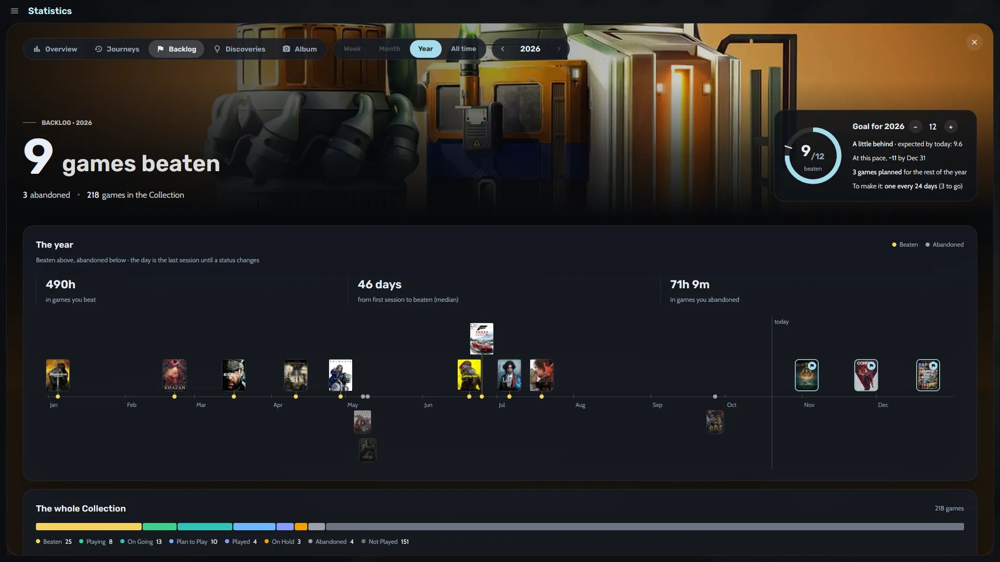
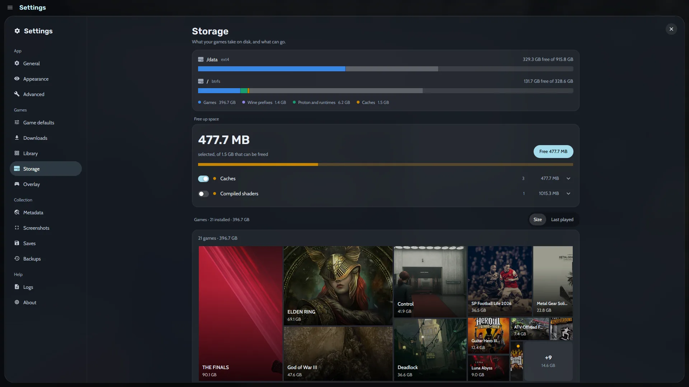
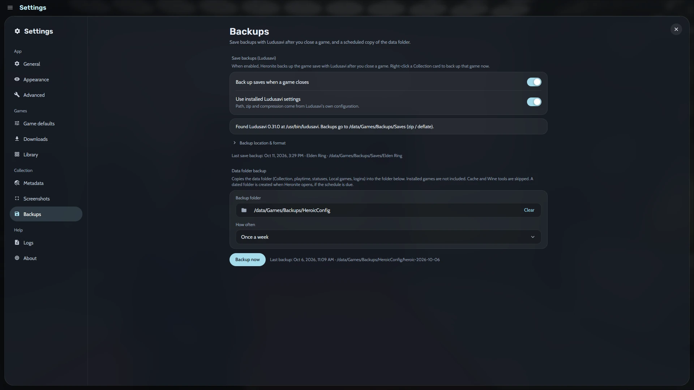

<h1 align="center">Heronite</h1>

<p align="center">
  <a href="https://github.com/RafaelGoulartB/Heronite">
    
  </a>
  <a href="LICENSE">
    
  </a>
  <a href="https://github.com/RafaelGoulartB/Heronite/releases/latest">
    
  </a>
  
  
  <a href="https://github.com/RafaelGoulartB/Heronite/releases">
    
  </a>
</p>

<p align="center">
  Every game you own, on Linux and Windows, in one fast native launcher.
</p>

https://github.com/user-attachments/assets/438452ac-dc6e-46fa-b443-9d85e94dca54

Heronite brings your games from Steam, Epic Games, GOG, Amazon Games, Battle.net, EA app, Ubisoft Connect, and Rockstar Games, plus emulated, native Linux, and Windows games, into one Collection. It launches them natively, through Wine/Proton on Linux, or through an emulator, records every session, and [stays light on your PC](#light-on-your-pc) as a native Rust app (GPUI, GPU rendered).

## Your library, organized

- **Collection:** a list with a details panel (Focus) or a grid of covers. Group by status, store, genre, series, year and more. The details show screenshots, How Long To Beat, achievements, a play timeline, and on Linux the ProtonDB and anti-cheat status.
- **Journal:** notes on the days you played and on your screenshots, and where you left off.
- **Views:** filter, sort, and save presets (Playing now, Backlog, Finished, Favourites). Search forgives accents and typos.
- **Bulk edits:** change many games at once, with undo; rename and merge genres, companies, and series.
- **Command palette:** <kbd>Ctrl</kbd> <kbd>K</kbd> opens any page, runs any action, or plays a game.
- **Add any game:** native Linux and Windows programs, browser games, install scripts, or ROM folders. Art from Steam, SteamGridDB, IGDB, Lutris, the web, or your screenshots. On first run, Heronite finds your Steam library, emulators, and ROM folders by itself.

<table>
  <tr>
    <td width="50%" align="center"><a href="assets/screenshots/collection.webp"></a><br /><sub><b>Collection</b></sub></td>
    <td width="50%" align="center"><a href="assets/screenshots/command-palette.webp"></a><br /><sub><b>Command palette</b></sub></td>
  </tr>
</table>

## Stores and launchers

- **Epic Games, GOG, and Amazon Games:** log in from Heronite. One download queue installs, updates, repairs, moves, imports, and uninstalls; it pauses offline and retries failed downloads. On Windows, games installed by the Epic Games Launcher, GOG Galaxy, or the Amazon Games app come in without downloading them again.
- **Steam:** your library comes in by itself, no login needed.
- **Battle.net, EA app, Ubisoft Connect, and Rockstar Games (Linux):** Heronite sets up each store's own app in a Wine prefix of its own. The games you install there show up in your Collection and start from it.
- **Other launchers (Linux):** bring in the games of Heroic, Lutris, Bottles, and Faugus, and keep them in sync.
- **Games you already have:** add a program by hand, or point at a folder and add every game found in it at once (Windows programs, and on Linux also AppImages, start scripts, and Linux programs).

## Configure and play

- **Wine and Proton (Linux):** per-game Wine version and prefix, DXVK-NVAPI, Esync/Fsync, gamescope, FPS limit, GPU choice, DLSS/FSR/XeSS upgrades, Winetricks, umu protonfixes, and Lossless Scaling frame generation (lsfg-vk).
- **Wine Manager (Linux):** download and update Proton-CachyOS, GE-Proton, DW-Proton, UMU-Proton, Proton-EM, and Proton-Sarek, and manage prefixes.
- **Launching:** follow and cancel each step, and add your own actions next to Play. On Linux, also run scripts before and after and programs alongside.
- **Sandbox (Linux):** run a game you do not trust through bubblewrap, with no network and no access to your home folder. Let one thing through when it needs more.
- **Emulators:** detect installed emulators or add your own with RetroArch cores, scan ROM folders, and continue from save states.
- **In-game overlay (beta, Linux):** the controller's Guide button opens volume, microphone, FPS limit, screenshots, and journal notes over the game.
- **Replay (off by default, Linux):** keep the last seconds of play and save them as a moment with Guide + X, recorded on the GPU by [gpu-screen-recorder](https://git.dec05eba.com/gpu-screen-recorder/about/).

<table>
  <tr>
    <td width="50%" align="center"><a href="assets/screenshots/game-settings.webp"></a><br /><sub><b>Game settings</b></sub></td>
    <td width="50%" align="center"><a href="assets/screenshots/wine-manager.webp"></a><br /><sub><b>Wine Manager</b></sub></td>
  </tr>
</table>

## Look back at what you played

- **Statistics:** play time by week, month, year, or all time in five tabs: Overview, Journeys, Backlog (a yearly goal of games to beat), Discoveries, and Album.
- **Year in review:** your year as full-screen stories, with a card to share.
- **Sessions:** every launch is recorded, screenshots are matched to the game, and sessions can be edited. Captures go to `Pictures/Heronite` (the portable copy's `Screenshots` folder on Windows) until you choose another folder.

<table>
  <tr>
    <td width="50%" align="center"><a href="assets/screenshots/statistics.webp"></a><br /><sub><b>Overview</b></sub></td>
    <td width="50%" align="center"><a href="assets/screenshots/year-in-review.webp"></a><br /><sub><b>Year in review</b></sub></td>
  </tr>
  <tr>
    <td width="50%" align="center"><a href="assets/screenshots/stats-backlog.webp"></a><br /><sub><b>Backlog</b></sub></td>
  </tr>
</table>

## Console mode

A controller-first layout for the couch or a TV, with an on-screen keyboard and a Power menu. Turn it on from the palette, the ☰ menu, or with `--console`.

- **Themes:** change every part of it, live from the couch or in Settings → Console mode: up to four tabs with their own layout (Shelves, Spotlight, Cinema, Dashboard, Grid, Wheel, Carousel, Series X), covers, background, colours, fonts, button glyphs, menus, and game pages.
- **Share them:** seven built-in themes (Minimal, Classic, Cinema, Pulse, Arcade, Hub, Living room). Export your own to a `.heronite-theme.json` file and import it anywhere.
- **Light when off:** nothing of it loads while console mode is off. It can open at startup or when a controller connects.

<table>
  <tr>
    <td width="50%" align="center"><a href="assets/screenshots/console-home.webp"></a><br /><sub><b>Home</b></sub></td>
    <td width="50%" align="center"><a href="assets/screenshots/console-game.webp"></a><br /><sub><b>Game page</b></sub></td>
  </tr>
</table>

## Make it yours

- **Appearance:** dark or light theme (or the desktop's), accent colour (or the game's), fonts, density, cover style, and a background picture or slideshow.
- **Language:** English, Portuguese (Brazil), Spanish, and German, following the system by default.
- **Saves and backups:** Ludusavi save backups after each session, and scheduled backups of your Collection, history, settings, and art.
- **Storage:** see what your games take on each disk and clean up leftovers.
- **Startup:** start with the system, and launch games from `heronite://launch` links or `--launch`.

<table>
  <tr>
    <td width="50%" align="center"><a href="assets/screenshots/appearance.webp"></a><br /><sub><b>Appearance</b></sub></td>
    <td width="50%" align="center"><a href="assets/screenshots/storage.webp"></a><br /><sub><b>Storage</b></sub></td>
  </tr>
  <tr>
    <td width="50%" align="center"><a href="assets/screenshots/backups.webp"></a><br /><sub><b>Backups</b></sub></td>
    <td width="50%" align="center"><a href="assets/screenshots/screenshots.webp"></a><br /><sub><b>Screenshots</b></sub></td>
  </tr>
</table>

## Light on your PC

A single native process that draws its UI on the GPU, with no bundled browser engine. When idle, it does almost no work.

| | Heronite |
|---|---|
| Memory while idle | **~190 MB** in a single process, **~95 MB** closed to the tray |
| CPU while idle | **~0.1%** (0.05 s of CPU time over 60 s) |
| Install size | **64 MB** (app + store login helper) |
| Start to library on screen | **~215 ms** median |

## Download

Every [release](https://github.com/RafaelGoulartB/Heronite/releases/latest) has an AppImage and packages for Debian/Ubuntu, Fedora/openSUSE, and Arch, and an installer and a portable zip for Windows:

| System | File | Install |
|---|---|---|
| Any distribution (**recommended**) | `Heronite-x86_64.AppImage` | `chmod +x Heronite-x86_64.AppImage && ./Heronite-x86_64.AppImage` |
| Debian 12+, Ubuntu 22.04+, Mint, Pop!_OS | `heronite_<version>-1_amd64.deb` | `sudo apt install ./heronite_*_amd64.deb` |
| Fedora 36+, openSUSE | `heronite-<version>-1.x86_64.rpm` | `sudo dnf install ./heronite-*.x86_64.rpm` |
| Arch, Manjaro, EndeavourOS, CachyOS | `heronite-<version>-1-x86_64.pkg.tar.zst` | `sudo pacman -U heronite-*-x86_64.pkg.tar.zst` |
| Windows 10 and 11 (**recommended**) | `Heronite-Setup-x86_64.exe` | Run it: it installs for your user, no administrator rights needed |
| Windows 10 and 11, portable | `Heronite-Portable-x86_64.zip` | Extract it anywhere and run `Heronite\heronite.exe`; the library, settings, and screenshots stay in that folder |

Heronite updates itself, and every download is checked against its signing key. Keep the AppImage in a writable folder (like `~/Applications`) so it can update in place. The Windows files are not code-signed yet, so SmartScreen may warn about them: choose **More info**, then **Run anyway**.

## Run from source

You need stable Rust. On Linux, also `clang` and `lld`, a Vulkan driver, and GTK/WebKitGTK; on Windows, the Visual Studio Build Tools ("Desktop development with C++"). Heronite downloads legendary, gogdl, and nile itself; [Ludusavi](https://github.com/mtkennerly/ludusavi) is optional.

```bash
# quick build (the login window is its own binary, so build it too)
cargo build --profile quick -p heronite-epic-login && cargo run --profile quick -p heronite

# release build, installed for the current user (Linux)
scripts/install.sh

# installer and portable zip in dist\ (Windows, needs Inno Setup 6)
powershell -ExecutionPolicy Bypass -File scripts\windows\package.ps1
```

## Development

A Cargo workspace: `app/` is the GPUI binary, `crates/` holds the GPUI-free libraries, and `heronite-epic-login` is the separate store login window.

```bash
cargo fmt --all
cargo clippy --workspace --all-targets
cargo test --workspace
```

See [ARCHITECTURE.md](docs/ARCHITECTURE.md), [CODE-STYLE.md](docs/CODE-STYLE.md), and [UI-CONVENTIONS.md](docs/UI-CONVENTIONS.md). To release, merge a pull request labelled `release:patch`, `release:minor`, or `release:major`. Issues and pull requests are welcome.

## License

Copyright (C) 2026 [Rafael Goulart](https://www.linkedin.com/in/rafael-goulartb/)

Licensed under the [GNU General Public License v3.0](LICENSE). Third-party components keep their own licenses; see [THIRD-PARTY-NOTICES.md](THIRD-PARTY-NOTICES.md).
