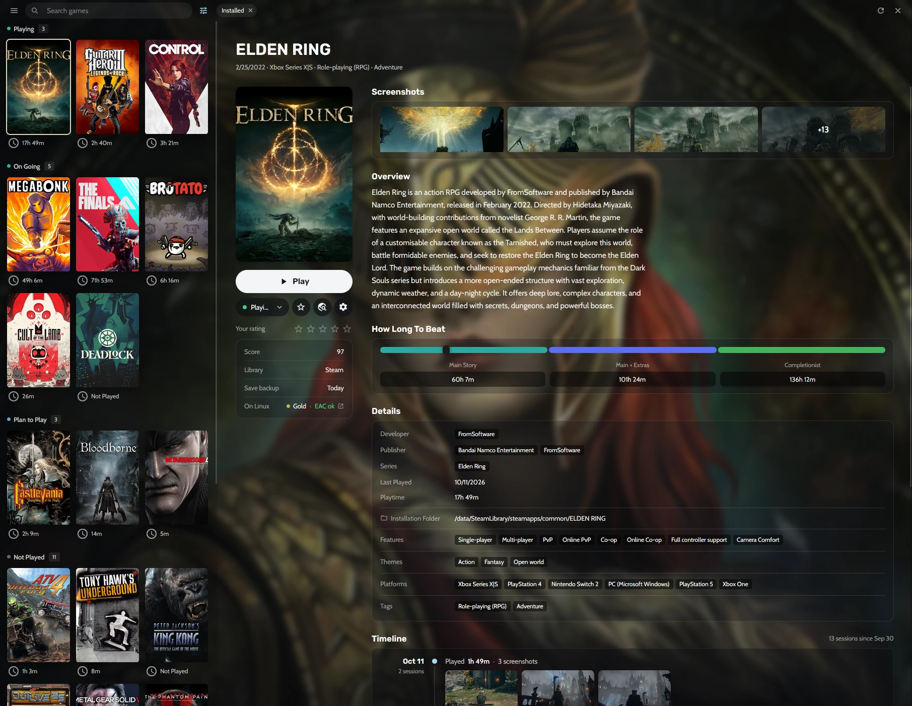
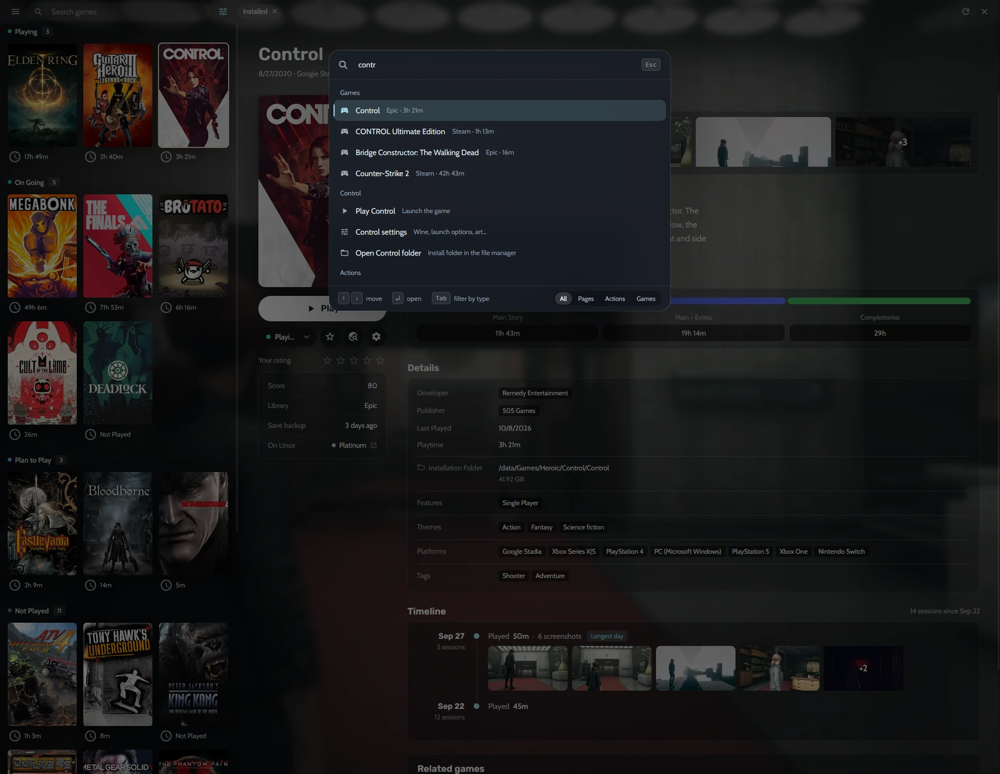
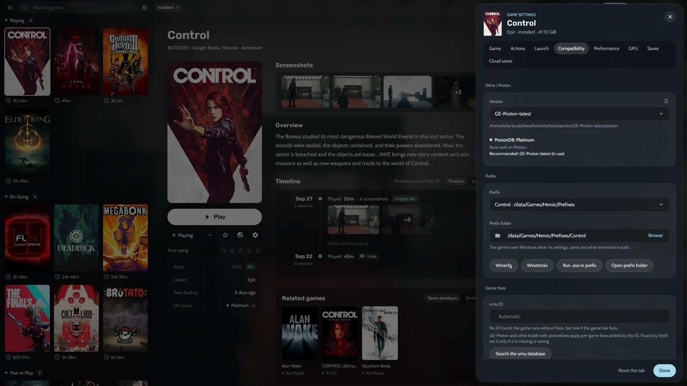
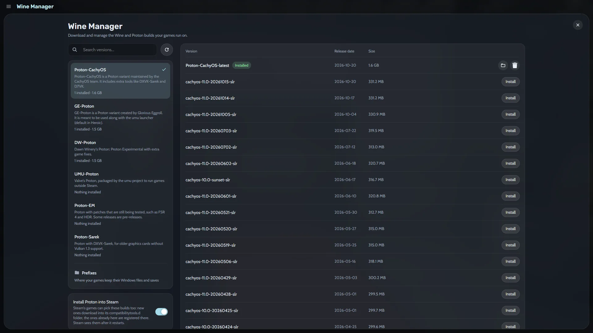
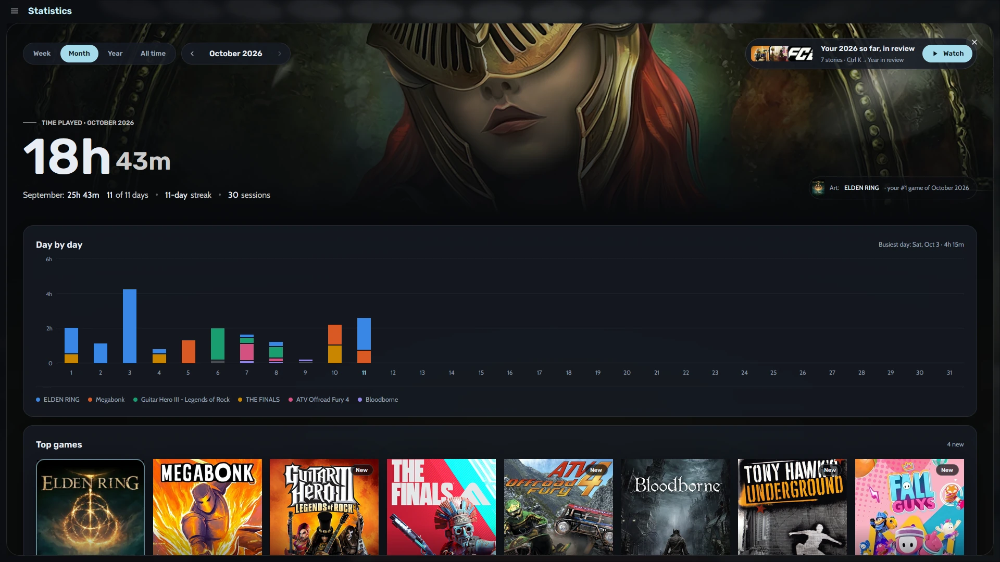
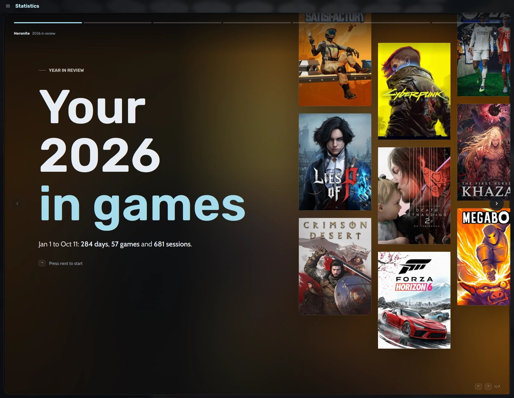
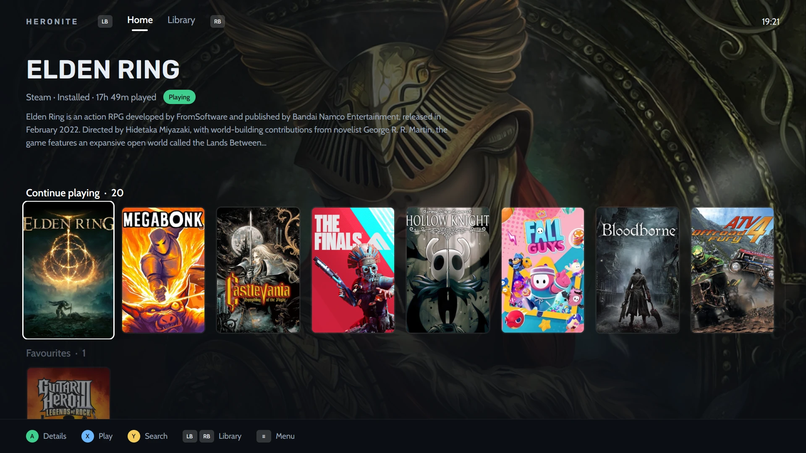
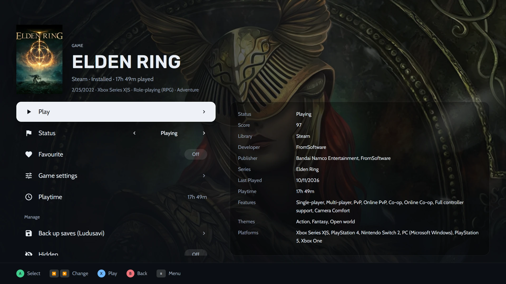
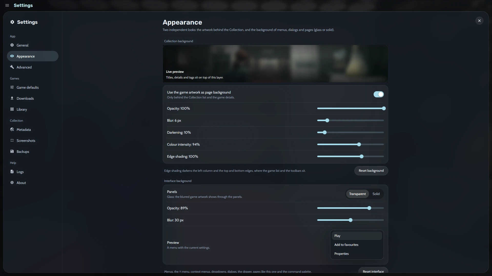
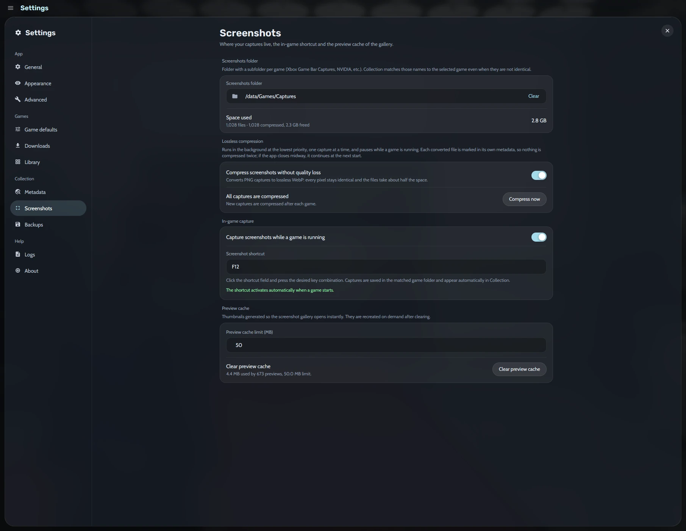

<h1 align="center">Heronite</h1>

<p align="center">
  <a href="https://github.com/RafaelGoulartB/Heronite">
    
  </a>
  <a href="LICENSE">
    
  </a>
  <a href="https://github.com/RafaelGoulartB/Heronite/releases/latest">
    
  </a>
  
  
  <a href="https://github.com/RafaelGoulartB/Heronite/releases">
    
  </a>
</p>

<p align="center">
  Every game you own, on Linux, in one fast native launcher.
</p>

https://github.com/user-attachments/assets/438452ac-dc6e-46fa-b443-9d85e94dca54

> [!NOTE]
> **Windows support is coming soon.** Heronite runs on Linux today, and a Windows version is on the way.

Heronite puts your Steam, Epic Games, GOG, Amazon Games, emulated, native Linux, and Windows games into one Collection, launches them through Wine/Proton or an emulator, and records every session. It is a native Rust app (GPUI, GPU rendered) that [stays light on your PC](#light-on-your-pc).

## Your library, organized

- **Collection:** every game in a list or a grid of covers, grouped by status, store, genre, series, year and more. The details panel shows screenshots, How Long To Beat, ProtonDB and anti-cheat status, achievements, and a play timeline that doubles as a journal.
- **View menu:** filter, sort, and save the view as a preset (Playing now, Backlog, Finished, and Favourites built in). Search forgives accents and typos.
- **Bulk edits:** change status, categories, and other fields of many games at once, with undo. A fields manager renames and merges genres, companies, and series.
- **Command palette:** <kbd>Ctrl</kbd> <kbd>K</kbd> jumps to any page, runs any action, or finds and plays a game.
- **Add any game:** native Linux programs, Windows programs, browser games, or ROMs from a folder. Art comes from Steam, SteamGridDB, IGDB, Lutris, the web, or your own screenshots.

<table>
  <tr>
    <td width="50%" align="center"><a href="assets/screenshots/collection.webp"></a><br /><sub><b>Collection</b></sub></td>
    <td width="50%" align="center"><a href="assets/screenshots/command-palette.webp"></a><br /><sub><b>Command palette</b></sub></td>
  </tr>
</table>

## Install, configure, and play

- **Stores:** Steam (no login needed), Epic Games, GOG, and Amazon Games. Install, update, repair, move, import, and uninstall through one download queue, with cloud saves and DLC where the store supports them.
- **Wine and Proton:** per-game Wine version, prefix, DXVK-NVAPI, Esync/Fsync, gamescope, FPS limit, DLSS/FSR/XeSS upgrades, Winetricks, protonfixes via umu, and Lossless Scaling frame generation (lsfg-vk).
- **Wine Manager:** download and update Proton-CachyOS, GE-Proton, DW-Proton, UMU-Proton, Proton-EM, and Proton-Sarek, and manage Wine prefixes.
- **Emulators:** detect installed emulators or add your own with RetroArch cores, scan ROM folders, and continue from save states.

<table>
  <tr>
    <td width="50%" align="center"><a href="assets/screenshots/game-settings.webp"></a><br /><sub><b>Game settings</b></sub></td>
    <td width="50%" align="center"><a href="assets/screenshots/wine-manager.webp"></a><br /><sub><b>Wine Manager</b></sub></td>
  </tr>
</table>

## Look back at what you played

- **Statistics:** play time by week, month, year, or all time, with charts, records, a yearly backlog goal, timelines of each game, and an album of your screenshots.
- **Year in review:** your year told as full-screen stories, with a summary card to share.
- **Sessions and screenshots:** every launch is recorded, and in-game screenshots are matched to the game and its timeline.

<table>
  <tr>
    <td width="50%" align="center"><a href="assets/screenshots/statistics.webp"></a><br /><sub><b>Statistics</b></sub></td>
    <td width="50%" align="center"><a href="assets/screenshots/year-in-review.webp"></a><br /><sub><b>Year in review</b></sub></td>
  </tr>
</table>

## Console mode

A controller-first layout for the couch or a TV that covers the whole app, with an on-screen keyboard. Turn it on from the palette, the ☰ menu, or with `--console`.

<table>
  <tr>
    <td width="50%" align="center"><a href="assets/screenshots/console-home.webp"></a><br /><sub><b>Home</b></sub></td>
    <td width="50%" align="center"><a href="assets/screenshots/console-game.webp"></a><br /><sub><b>Game page</b></sub></td>
  </tr>
</table>

## Make it yours

- **Appearance:** tune the game art behind the Collection, pick glass or solid panels, and choose the cover aspect ratio.
- **Backups:** back up saves with Ludusavi after each session, restore them into any prefix, and schedule backups of your Collection and settings.
- **Storage:** see what your games take on each disk and clean up leftovers in one click.
- **Startup:** start with the system, launch games via `heronite://launch` links or `--launch`.

<table>
  <tr>
    <td width="50%" align="center"><a href="assets/screenshots/appearance.webp"></a><br /><sub><b>Appearance</b></sub></td>
    <td width="50%" align="center"><a href="assets/screenshots/screenshots.webp"></a><br /><sub><b>Screenshots</b></sub></td>
  </tr>
</table>

## Light on your PC

A single native process that draws its UI on the GPU, with no bundled browser engine. When idle, it does no work.

| | Heronite |
|---|---|
| Memory while idle | **~195 MB** in a single process |
| CPU while idle | **0.0%** (no CPU time used over 60 s) |
| Install size | **47 MB** (app + store login helper) |
| Start to library on screen | **~335 ms** median |

## Your data

Everything stays on your machine, in Heroic-compatible files under `~/.local/share/heronite/` (override with `HERONITE_DATA_DIR`). On first start, Heronite copies an existing Heroic setup once, without ever writing to Heroic's folders. For IGDB metadata, add your Twitch client ID and secret in **Settings > Metadata**.

## Download

Every [release](https://github.com/RafaelGoulartB/Heronite/releases/latest) has an AppImage and packages for Debian/Ubuntu, Fedora/openSUSE, and Arch:

| System | File | Install |
|---|---|---|
| Any distribution (**recommended**) | `Heronite-x86_64.AppImage` | `chmod +x Heronite-x86_64.AppImage && ./Heronite-x86_64.AppImage` |
| Debian 12+, Ubuntu 22.04+, Mint, Pop!_OS | `heronite_<version>-1_amd64.deb` | `sudo apt install ./heronite_*_amd64.deb` |
| Fedora 36+, openSUSE | `heronite-<version>-1.x86_64.rpm` | `sudo dnf install ./heronite-*.x86_64.rpm` |
| Arch, Manjaro, EndeavourOS, CachyOS | `heronite-<version>-1-x86_64.pkg.tar.zst` | `sudo pacman -U heronite-*-x86_64.pkg.tar.zst` |

Heronite updates itself: a card offers new versions, and every download is checked against its signing key. Keep the AppImage in a writable folder (like `~/Applications`) so it can update in place.

## Run from source

You need a stable Rust toolchain, `clang` and `lld`, a Vulkan-capable GPU driver, and GTK/WebKitGTK. Heronite downloads legendary, gogdl, and nile on its own; [Ludusavi](https://github.com/mtkennerly/ludusavi) is optional for save backups.

```bash
# quick build (the login window is its own binary, so build it too)
cargo build --profile quick -p heronite-epic-login && cargo run --profile quick -p heronite

# release build, installed for the current user
scripts/install.sh
```

## Development

A Cargo workspace: `app/` is the GPUI binary, `crates/` holds the GPUI-free libraries, and `heronite-epic-login` is the separate store login window.

```bash
cargo fmt --all
cargo clippy --workspace --all-targets
cargo test --workspace
```

See [ARCHITECTURE.md](docs/ARCHITECTURE.md), [CODE-STYLE.md](docs/CODE-STYLE.md), and [UI-CONVENTIONS.md](docs/UI-CONVENTIONS.md). To release, merge a pull request labelled `release:patch`, `release:minor`, or `release:major`. Issues and pull requests are welcome.

## License

Copyright (C) 2026 [Rafael Goulart](https://www.linkedin.com/in/rafael-goulartb/)

Licensed under the [GNU General Public License v3.0](LICENSE). Heronite builds on the [Heroic Games Launcher](https://github.com/Heroic-Games-Launcher/HeroicGamesLauncher), also GPL-3.0. Third-party components keep their own licenses; see [THIRD-PARTY-NOTICES.md](THIRD-PARTY-NOTICES.md).
