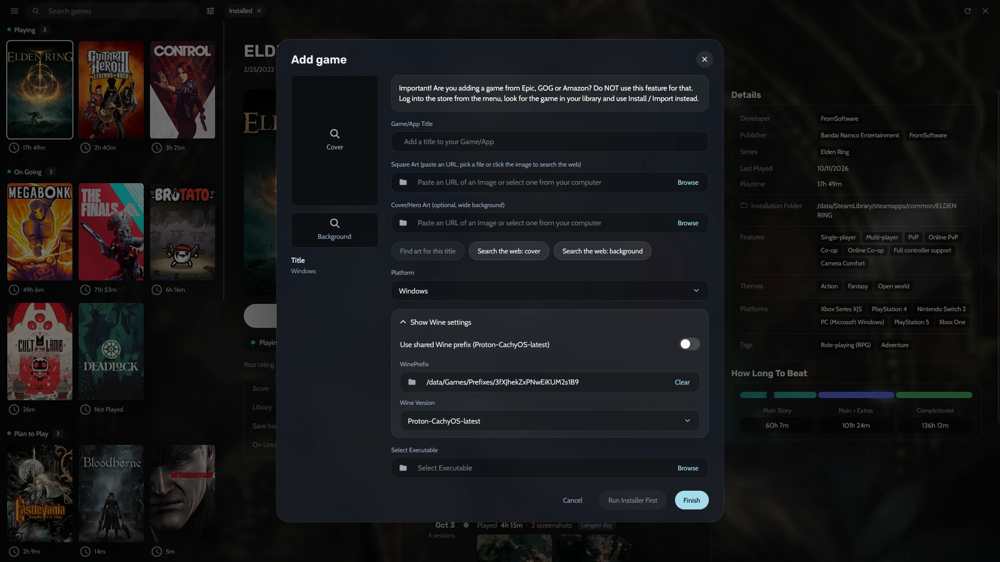
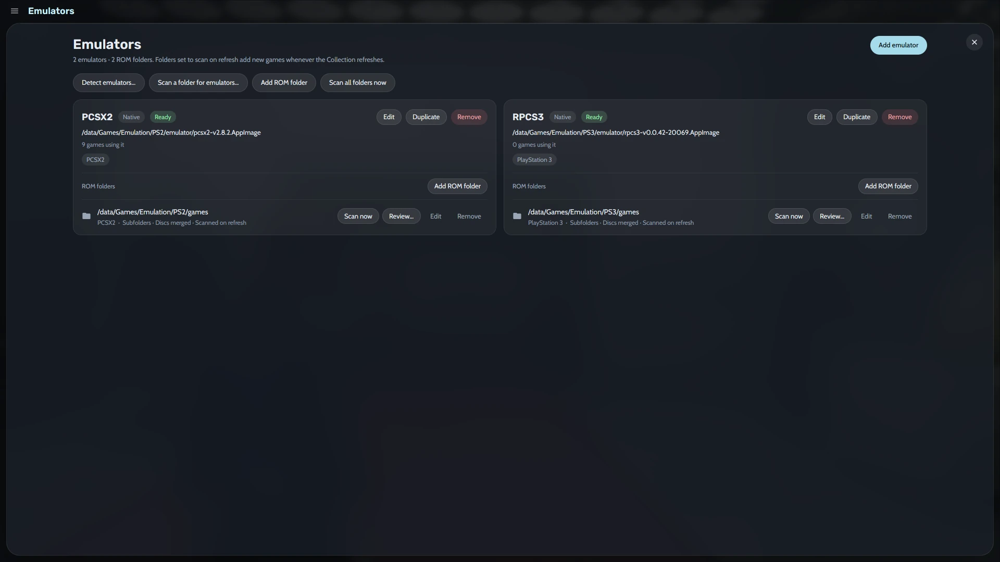
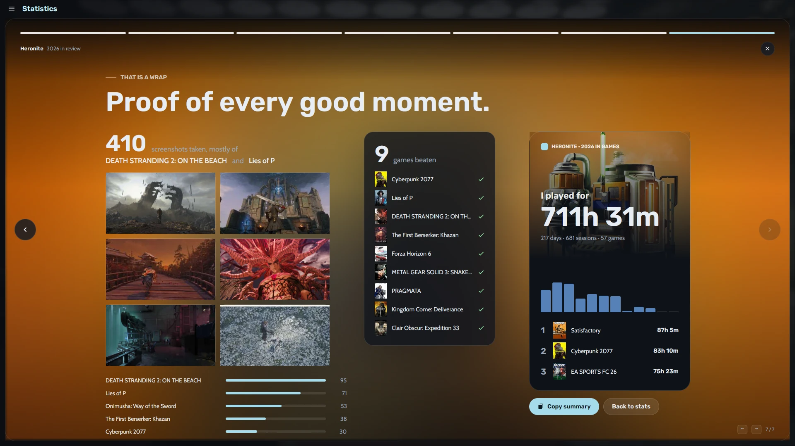
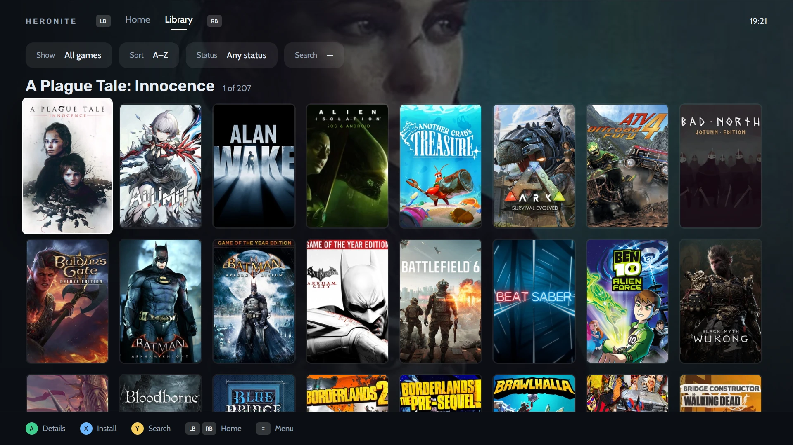

<h1 align="center">Heronite</h1>

<p align="center">
  <a href="https://www.linkedin.com/in/rafael-goulartb/">
    
  </a>
  <a href="docs/ARCHITECTURE.md">
    
  </a>
  <a href="https://github.com/RafaelGoulartB/game-launcher/graphs/commit-activity">
    
  </a>
  <a href="LICENSE">
    
  </a>
  
  
  
  
</p>

<p align="center">
  Every game you own, on Linux, in one fast native launcher.
</p>

<p align="center">
  <a href="docs/ARCHITECTURE.md">Architecture</a> &middot;
  <a href="docs/UI-CONVENTIONS.md">UI conventions</a> &middot;
  <a href="docs/CODE-STYLE.md">Code style</a>
</p>

Heronite puts your Steam, Epic Games, emulated, native Linux, and Windows games into one Collection. You can sort them by your own statuses, fill in their metadata and art, and launch them through Wine/Proton or an emulator. Each session is recorded, so you can see how much you played and which screenshots you took.

Heronite is a native Rust app (GPUI, GPU rendered) that [stays light on memory, CPU, and disk](#light-on-your-pc). **Linux only**: Wine/Proton, gamescope, Ludusavi, the system tray, and desktop shortcuts all depend on Linux integrations.

## Your library, organized

- **Collection:** one screen for every game. Covers are grouped by status (Playing, On Going, Plan to Play, Not Played, or your own), and the selected game's art fills the background. The details panel shows screenshots, How Long To Beat times, ProtonDB tier and anti-cheat status, achievements, your rating, the last save backup, and a timeline of every day you played.
- **Command palette:** press <kbd>Ctrl</kbd> <kbd>K</kbd> to jump to any page, run any action, or find a game and play it, open its settings or its folder. Pages also have direct shortcuts (<kbd>Ctrl</kbd> <kbd>1</kbd> to <kbd>6</kbd>, <kbd>Ctrl</kbd> <kbd>,</kbd>, <kbd>Ctrl</kbd> <kbd>N</kbd>).
- **Add any game:** add a native Linux program, a Windows program (run through Wine/Proton), a browser game, or a ROM. Covers and backgrounds can come from IGDB, Steam, Lutris, a web image search, or one of your own screenshots.

<table>
  <tr>
    <th width="33%">Collection</th>
    <th width="33%">Command palette</th>
    <th width="33%">Add a game</th>
  </tr>
  <tr>
    <td><a href="assets/screenshots/collection.webp"></a></td>
    <td><a href="assets/screenshots/command-palette.webp"></a></td>
    <td><a href="assets/screenshots/add-game.webp"></a></td>
  </tr>
</table>

## Install, configure, and play

- **Epic Games:** log in, install, update, repair, move, and uninstall games, manage DLC, and sync cloud saves. Downloads run through a queue you can reorder.
- **Wine and Proton:** each Windows game gets Heroic's full settings (Wine version and prefix, DXVK-NVAPI, Esync/Fsync, gamescope, launch options, environment variables). The Wine Manager downloads and updates GE-Proton and Proton-CachyOS.
- **Emulators:** detect installed emulators (PATH, Flatpak, AppImages) or add your own with profiles and RetroArch cores. Scan ROM folders to import games, with multi-disc games merged into one entry, and continue from a save state.

<table>
  <tr>
    <th width="33%">Game settings</th>
    <th width="33%">Wine Manager</th>
    <th width="33%">Emulators</th>
  </tr>
  <tr>
    <td><a href="assets/screenshots/game-settings.webp"></a></td>
    <td><a href="assets/screenshots/wine-manager.webp"></a></td>
    <td><a href="assets/screenshots/emulators.webp"></a></td>
  </tr>
</table>

## Look back at what you played

- **Statistics:** see your play time for a week, a month, a year, or all time. The page shows a day-by-day chart, your top games, when you usually play, your records, and the genres you play most.
- **Year in review:** your year told as seven full-screen stories: the big number, your number one game, the top five, your habits, your records, and a summary card you can copy.
- **Sessions and screenshots:** each launch is recorded as a session. Screenshots taken in game with a shortcut are matched to the game and its timeline, and can be compressed to lossless WebP in the background.

<table>
  <tr>
    <th width="33%">Statistics</th>
    <th width="33%">Year in review</th>
    <th width="33%">Year in review summary</th>
  </tr>
  <tr>
    <td><a href="assets/screenshots/statistics.webp"></a></td>
    <td><a href="assets/screenshots/year-in-review.webp"></a></td>
    <td><a href="assets/screenshots/year-in-review-wrap.webp"></a></td>
  </tr>
</table>

## Console mode

A controller-first layout for the couch or a TV. It covers the whole app: the library, game pages, downloads, the Wine Manager, Epic, emulators, statistics, and settings. You can use a gamepad or the keyboard, and an on-screen keyboard is available for text fields. Turn it on from the palette (**Console mode**); Heronite remembers it on the next start. The desktop layout does not change.

<table>
  <tr>
    <th width="33%">Home</th>
    <th width="33%">Game page</th>
    <th width="33%">Library</th>
  </tr>
  <tr>
    <td><a href="assets/screenshots/console-home.webp"></a></td>
    <td><a href="assets/screenshots/console-game.webp"></a></td>
    <td><a href="assets/screenshots/console-library.webp"></a></td>
  </tr>
</table>

## Make it yours

- **Appearance:** set the opacity, blur, darkening, and colour intensity of the game art behind the Collection. Panels can be glass or solid, and covers can use the Steam (2:3), IGDB (3:4), GOG (11:15), or other aspect ratios.
- **Screenshots:** set the capture folder and the in-game shortcut, compress captures without quality loss, and limit the preview cache.
- **Backups:** back up saves with Ludusavi after each game closes (or manually from the game's menu), and schedule copies of the whole data folder.

<table>
  <tr>
    <th width="33%">Appearance</th>
    <th width="33%">Screenshots</th>
    <th width="33%">Backups</th>
  </tr>
  <tr>
    <td><a href="assets/screenshots/appearance.webp"></a></td>
    <td><a href="assets/screenshots/screenshots.webp"></a></td>
    <td><a href="assets/screenshots/backups.webp"></a></td>
  </tr>
</table>

<sub>Captured from the running app on Linux (Hyprland) with a real library. Click an image to view it at full resolution.</sub>

## Light on your PC

A game launcher should get out of the way when the game starts. Heronite is a single native process that draws its UI on the GPU, with no bundled browser engine. A web engine is only used by the Epic login window, which is a separate small program started when you log in. Slow work like scanning, metadata, image decoding, and compression runs on background threads. When the app sits idle, it does no work.

| | Heronite |
|---|---|
| Memory while idle | **~195 MB** in a single process |
| CPU while idle | **0.0%** (no CPU time used over 60 s) |
| Install size | **47 MB** (app + Epic login helper) |
| Start to library on screen | **~335 ms** median |


## Your data

Everything stays on your machine, in Heroic-compatible files: library, Collection, statuses, sessions, playtime, and settings live in `~/.local/share/heronite/` (override it with `HERONITE_DATA_DIR`). UI state goes in `~/.config/heronite/` and caches in `~/.cache/heronite/`.

On first start, if that folder does not exist yet, Heronite copies an existing Heroic setup into it **once**. It only reads Heroic's files and never writes to Heroic's folders, so both apps can stay installed.

Online features need connectivity: metadata and art (IGDB, Steam, Lutris, How Long To Beat, ProtonDB), Epic Games, and Wine/Proton downloads. For IGDB, add your own Twitch client ID and secret in **Settings > Metadata**.

## Run locally

You need a stable Rust toolchain, `clang` and `lld` (used as the linker, see `.cargo/config.toml`), a Vulkan-capable GPU driver, and GTK/WebKitGTK for the Epic login window. Optional tools: [legendary](https://github.com/derrod/legendary) for Epic Games and [Ludusavi](https://github.com/mtkennerly/ludusavi) for save backups.

```bash
# fast optimised build for trying the app
cargo run --profile quick -p heronite

# build in release mode and install for the current user
# (~/.local/opt/heronite-rs, a launcher in ~/.local/bin and a .desktop entry)
scripts/install.sh
```

## Development

The app is a Cargo workspace. `app/` is the GPUI binary (`heronite-rs`): the Collection screen, dialogs, ☰ pages, and console mode. The `crates/` folder holds the GPUI-free libraries: data files and Heroic migration, launching and playtime, Epic (legendary), emulation, metadata, screenshots and images, Wine/Proton, and shortcuts. A separate small binary handles the Epic login window, which keeps a web engine out of the main app.

```bash
cargo fmt --all
cargo clippy --workspace --all-targets
cargo test --workspace
cargo build --release -p heronite -p heronite-epic-login
```

`HERONITE_DEBUG_*` environment variables open a page, dialog, or menu at startup, for screenshots and tests without clicking. See [ARCHITECTURE.md](docs/ARCHITECTURE.md) for the crates and patterns, [CODE-STYLE.md](docs/CODE-STYLE.md) for the code rules, and [UI-CONVENTIONS.md](docs/UI-CONVENTIONS.md) for the look of the UI. Issues and pull requests are welcome.

## License

Copyright (C) 2026 [Rafael Goulart](https://www.linkedin.com/in/rafael-goulartb/)

This program is free software: you can redistribute it and/or modify it under the terms of the [GNU General Public License v3.0](LICENSE) as published by the Free Software Foundation. It is distributed WITHOUT ANY WARRANTY; see the license for details. Heronite builds on the [Heroic Games Launcher](https://github.com/Heroic-Games-Launcher/HeroicGamesLauncher), which is also licensed under the GPL-3.0.
