<h1 align="center"><a href="https://heronite.app">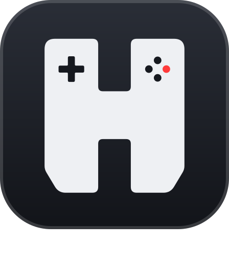</a> Heronite</h1>

<p align="center">
  <a href="https://github.com/RafaelGoulartB/Heronite"></a>
  <a href="https://github.com/RafaelGoulartB/Heronite/releases/latest"></a>
  <a href="https://github.com/RafaelGoulartB/Heronite/releases"></a>
  <a href="https://github.com/RafaelGoulartB/Heronite/actions/workflows/ci.yml"></a>
  
  <a href="LICENSE"></a>
</p>

<p align="center">
  Every game you own, on Linux and Windows, in one fast native launcher.
</p>

<p align="center">
  <a href="https://heronite.app"><b>Website</b></a> ·
  <a href="https://github.com/RafaelGoulartB/Heronite/releases/latest"><b>Download</b></a> ·
  <a href="https://github.com/RafaelGoulartB/Heronite/releases"><b>Release notes</b></a> ·
  <a href="https://github.com/RafaelGoulartB/Heronite/wiki"><b>Wiki</b></a>
</p>

<p align="center">
  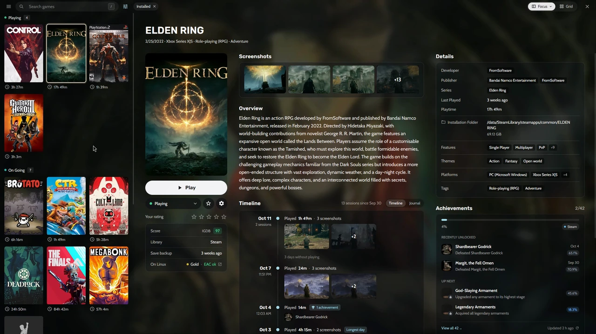
</p>

Heronite brings your games from Steam, Epic Games, GOG, Amazon Games, Xbox and PC Game Pass, Battle.net, EA app, Ubisoft Connect, and Rockstar Games, plus emulated, native Linux, and Windows games, into one Collection. It launches them natively, through Wine/Proton on Linux, or through an emulator, records every session, and [stays light on your PC](#light-on-your-pc) as a native Rust app (GPUI, GPU rendered).

Coming from Heroic, Lutris, Bottles, Faugus, or Playnite? Heronite imports your games from them.

## 📥 Download

<div align="center">

| Platform | Package | Download |
|:---|:---|:---|
| 🪟 Windows | Installer | [Heronite-Setup-x86_64.exe](https://github.com/RafaelGoulartB/Heronite/releases/latest/download/Heronite-Setup-x86_64.exe) |
| 🪟 Windows | Portable | [Heronite-Portable-x86_64.zip](https://github.com/RafaelGoulartB/Heronite/releases/latest/download/Heronite-Portable-x86_64.zip) |
| 🐧 Linux | AppImage (any distro, updates itself) | [Heronite-x86_64.AppImage](https://github.com/RafaelGoulartB/Heronite/releases/latest/download/Heronite-x86_64.AppImage) |
| 🐧 Arch, Debian, Fedora | .pkg.tar.zst, .deb, .rpm | [Latest release](https://github.com/RafaelGoulartB/Heronite/releases/latest) |

</div>

<details>
<summary><b>How to install</b></summary>

| System | File | Install |
|---|---|---|
| Any distribution (**recommended**) | `Heronite-x86_64.AppImage` | `chmod +x Heronite-x86_64.AppImage && ./Heronite-x86_64.AppImage` |
| Debian 12+, Ubuntu 22.04+, Mint, Pop!_OS | `heronite_<version>-1_amd64.deb` | `sudo apt install ./heronite_*_amd64.deb` |
| Fedora 36+, openSUSE | `heronite-<version>-1.x86_64.rpm` | `sudo dnf install ./heronite-*.x86_64.rpm` |
| Arch, Manjaro, EndeavourOS, CachyOS | `heronite-<version>-1-x86_64.pkg.tar.zst` | `sudo pacman -U heronite-*-x86_64.pkg.tar.zst` |
| Windows 10 and 11 (**recommended**) | `Heronite-Setup-x86_64.exe` | Run it: it installs for your user, no administrator rights needed |
| Windows 10 and 11, portable | `Heronite-Portable-x86_64.zip` | Extract it anywhere and run `Heronite\heronite.exe`; the library, settings, and screenshots stay in that folder |

</details>


<details>
<summary><b>Windows - Scoop</b></summary>

#### 🪟 Windows

With [Scoop](https://scoop.sh), from the [`scoop-heronite`](https://github.com/RafaelGoulartB/scoop-heronite) bucket:

```powershell
scoop bucket add heronite https://github.com/RafaelGoulartB/scoop-heronite
scoop install heronite/heronite
```

`scoop update heronite` installs new versions.

</details>

<details>
<summary><b>Fedora - COPR</b></summary>

#### 🐧 Fedora, Nobara, Ultramarine, Bazzite

From the [`rafaelgoulart/heronite`](https://copr.fedorainfracloud.org/coprs/rafaelgoulart/heronite/) COPR:

```bash
sudo dnf copr enable rafaelgoulart/heronite
sudo dnf install heronite
```

`sudo dnf upgrade` installs new versions.

On atomic desktops (Bazzite, Silverblue, Kinoite), add the [COPR repo file](https://copr.fedorainfracloud.org/coprs/rafaelgoulart/heronite/) to `/etc/yum.repos.d/`, then run `rpm-ostree install heronite`.

</details>


The Windows files are not code-signed yet, so SmartScreen may warn about them: choose **More info**, then **Run anyway**.

---

## Your library, organized

- **Collection:** a list with details or a grid of covers, grouped by status, store, genre, series, game mode (co-op, split screen...), or year, and filtered by any of those or by the tags Steam players gave a game. Details show screenshots, How Long To Beat, achievements, and a play timeline.
- **Journal:** notes on your play days and screenshots.
- **Views:** filter, sort, and save presets like Playing now or Backlog. Search forgives typos.
- **Bulk edits:** change many games at once, with undo.
- **Command palette:** <kbd>Ctrl</kbd> <kbd>K</kbd> opens any page, action, or game.
- **Add any game:** programs, browser games, scripts, or ROM folders, with art from Steam, SteamGridDB, IGDB, and more.

<table>
  <tr>
    <td width="50%" align="center"><a href="assets/screenshots/collection.webp">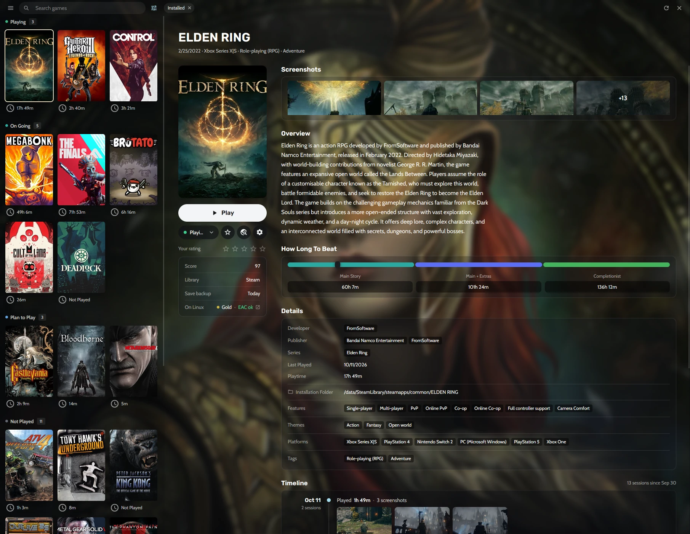</a><br /><sub><b>Collection</b></sub></td>
    <td width="50%" align="center"><a href="assets/screenshots/command-palette.webp">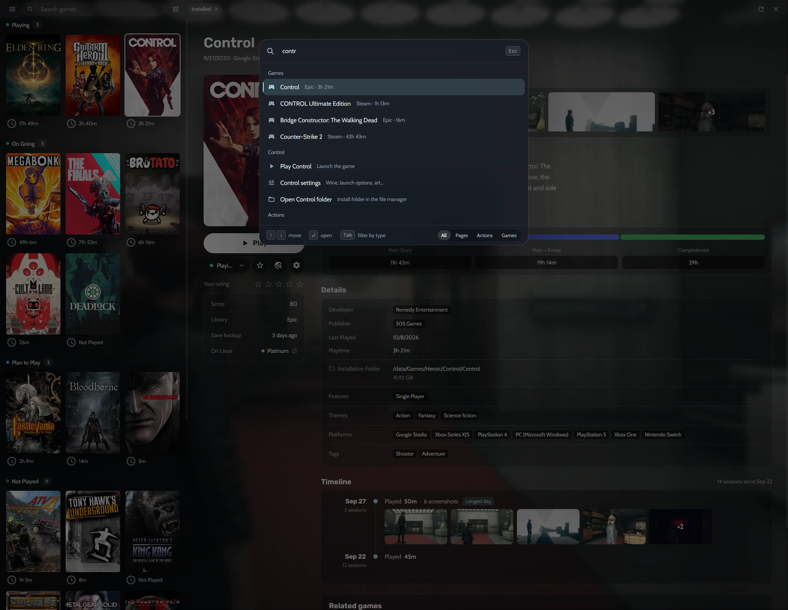</a><br /><sub><b>Command palette</b></sub></td>
  </tr>
</table>

## Stores and launchers

- **Epic Games, GOG, and Amazon Games:** log in and install, update, repair, or move games from one download queue. On Windows, games from their official launchers come in without downloading again.
- **Steam:** your library comes in by itself, no login needed.
- **Xbox and PC Game Pass (Windows):** Microsoft Store and Game Pass games show up in your Collection, launch from Heronite, and count their play time.
- **Battle.net, EA app, Ubisoft Connect, and Rockstar Games:** their games join your Collection, through the store's own app on Windows and in its own Wine prefix on Linux.
- **Other launchers:** import and sync games from Heroic, Lutris, Bottles, and Faugus on Linux, and from Heroic and Playnite on Windows (Settings → Other launchers).
- **Games you already have:** add one by hand, or a whole folder at once.

## Configure and play

- **Wine and Proton (Linux):** per-game version and prefix, DXVK, gamescope, FPS limit, DLSS/FSR upgrades, Winetricks, and Lossless Scaling frame generation.
- **Wine Manager (Linux):** download Proton-CachyOS, GE-Proton, and other builds, and manage prefixes.
- **Launching:** scripts before and after, programs alongside (like trainers), and presets to reuse.
- **Sandbox (Linux):** run untrusted games without network or access to your home folder.
- **Emulators:** detected by themselves or added with RetroArch cores, with ROM scanning and save states.
- **GOG achievements without GOG Galaxy:** [Comet](https://github.com/imLinguin/comet) runs beside GOG games on Windows and Linux, so what they unlock counts on your GOG account and shows over the game as it happens.
- **In-game overlay:** volume, screenshots and notes over the game; Linux also has live FPS limits and can show or hide MangoHud. Windows supports windowed/borderless games, with Ctrl+Shift+G or an XInput controller's Back+Start ([limits](docs/WINDOWS-MIGRATION.md#-in-game-overlay)).
- **Replay (Linux):** save the last seconds of play with Guide + X, recorded by [gpu-screen-recorder](https://git.dec05eba.com/gpu-screen-recorder/about/).

<table>
  <tr>
    <td width="50%" align="center"><a href="assets/screenshots/game-settings.webp">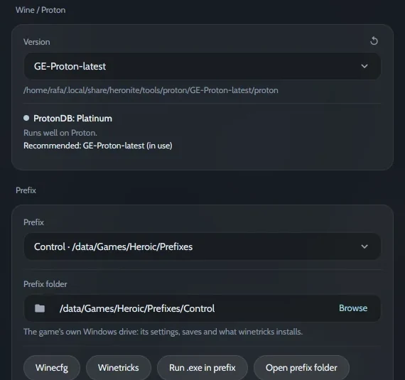</a><br /><sub><b>Proton and prefix, per game</b></sub></td>
    <td width="50%" align="center"><a href="assets/screenshots/wine-manager.webp">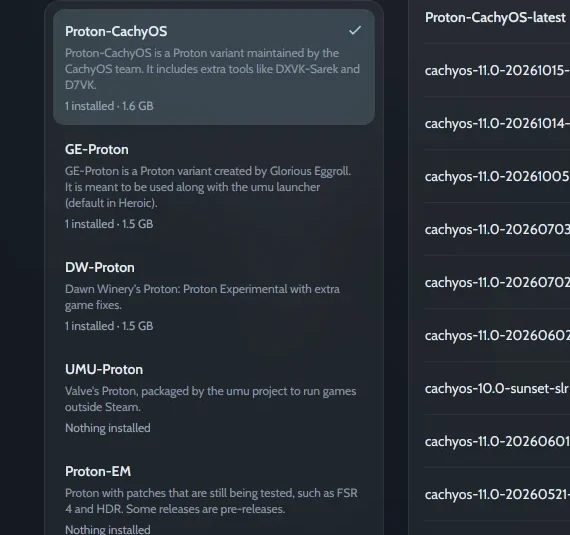</a><br /><sub><b>Wine Manager</b></sub></td>
  </tr>
</table>

## Look back at what you played

- **Statistics:** play time by week, month, or year, plus a yearly backlog goal.
- **Year in review:** your year as full-screen stories, with a card to share.
- **Sessions:** every launch is recorded, and screenshots are matched to the game.

<table>
  <tr>
    <td width="50%" align="center"><a href="assets/screenshots/statistics.webp">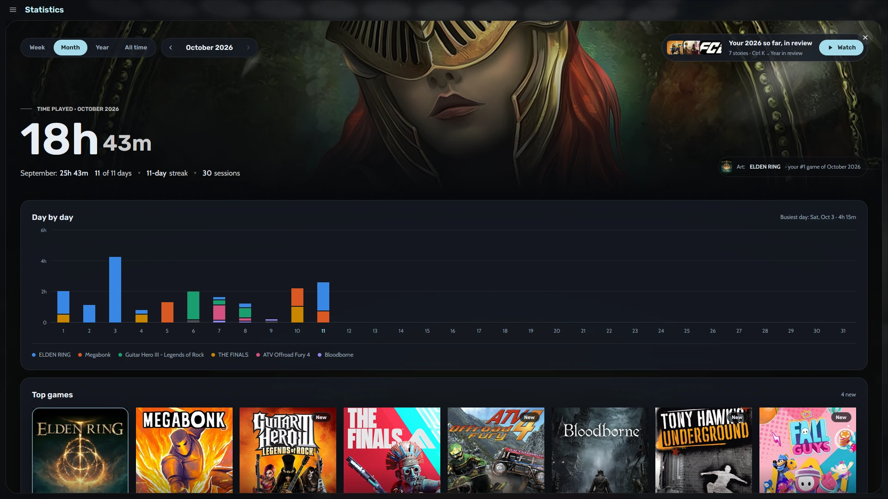</a><br /><sub><b>Overview</b></sub></td>
    <td width="50%" align="center"><a href="assets/screenshots/year-in-review.webp">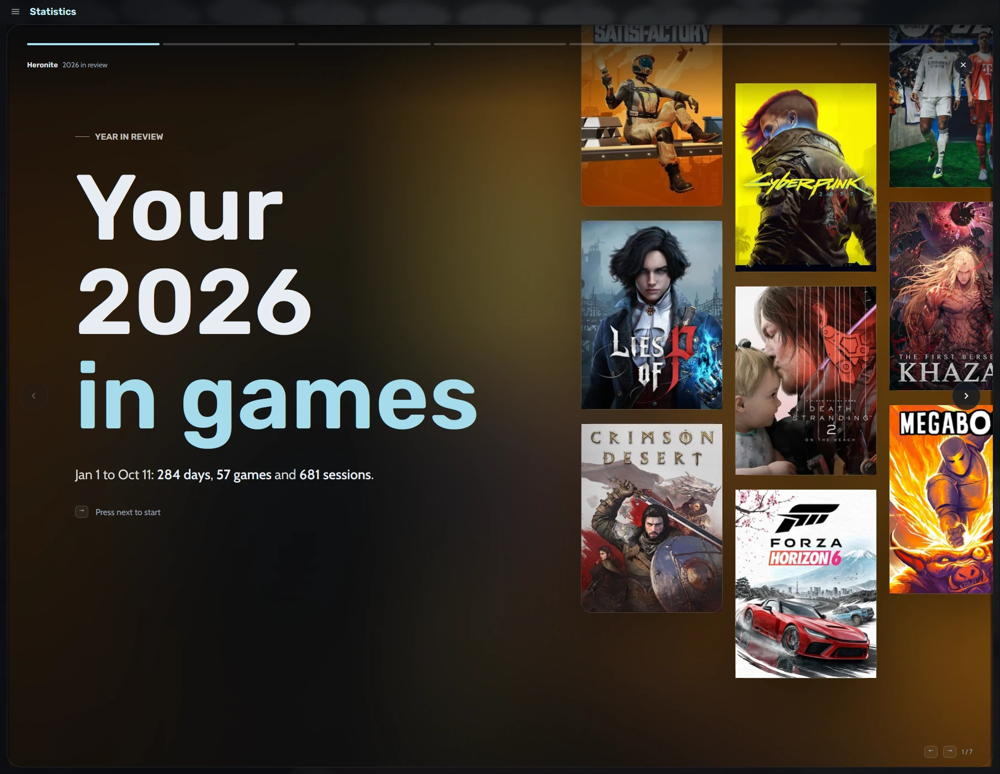</a><br /><sub><b>Year in review</b></sub></td>
  </tr>
  <tr>
    <td width="50%" align="center"><a href="assets/screenshots/stats-backlog.webp">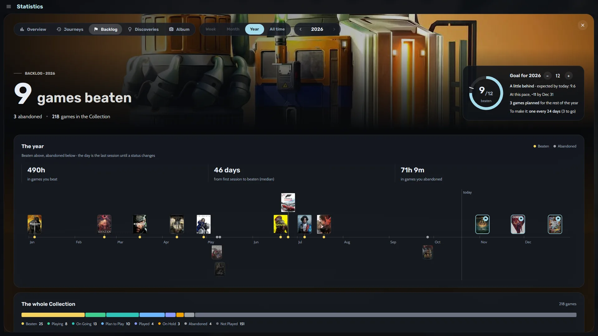</a><br /><sub><b>Backlog</b></sub></td>
    <td width="50%" align="center"><a href="assets/screenshots/year-in-review-wrap.webp">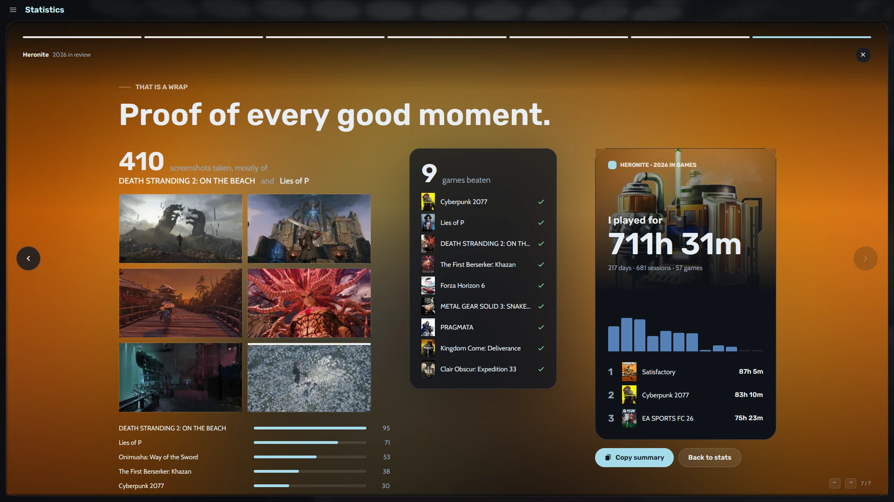</a><br /><sub><b>Share card</b></sub></td>
  </tr>
</table>

## Console mode

A controller-first layout for the couch or a TV. Turn it on from the ☰ menu, the palette, or with `--console`.

- **Themes:** eight layouts (Shelves, Spotlight, Cinema, Grid, Wheel, and more), with your own covers, colours, fonts, and menus.
- **Share them:** seven built-in themes, or export yours as a `.heronite-theme.json` file.
- **Light when off:** nothing loads until you turn it on. It can open at startup or when a controller connects.

<table>
  <tr>
    <td width="50%" align="center"><a href="assets/screenshots/console-home.webp">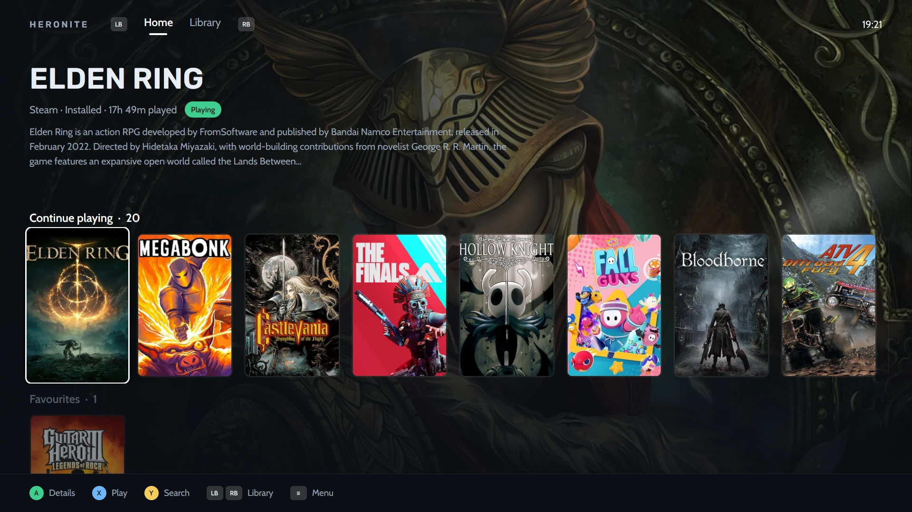</a><br /><sub><b>Home</b></sub></td>
    <td width="50%" align="center"><a href="assets/screenshots/console-game.webp">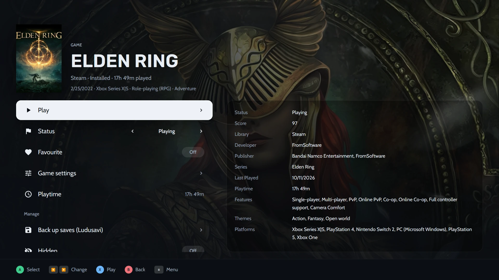</a><br /><sub><b>Game page</b></sub></td>
  </tr>
</table>

## Make it yours

- **Appearance:** dark or light, accent colour, fonts, density, and a background picture.
- **Language:** English, Portuguese (Brazil), Spanish, German, and French.
- **Saves and backups:** Ludusavi save backups after each session (and, if you choose, every 15 minutes to 2 hours while you play), and scheduled Collection backups.
- **Sync:** status, ratings, notes, and play time stay the same across your PCs or both sides of a dual boot, through a shared folder or a cloud account ([rclone](https://rclone.org/)), which can also keep your backups, saves, and screenshots.
- **Storage:** see what your games take on each disk and clean up leftovers.
- **Startup:** start with the system, and launch games from `heronite://` links.

<table>
  <tr>
    <td width="50%" align="center"><a href="assets/screenshots/console-settings.webp">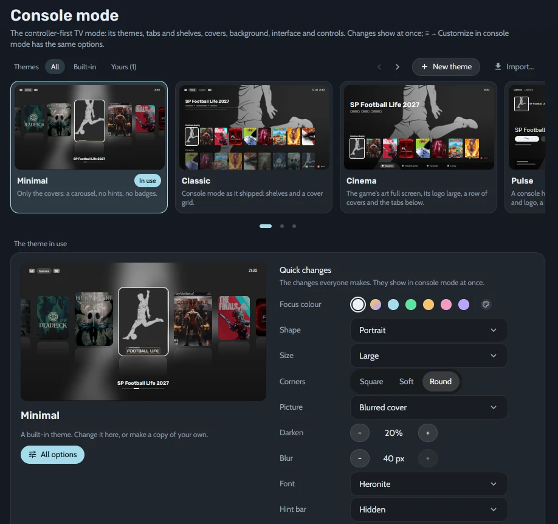</a><br /><sub><b>Console mode themes</b></sub></td>
    <td width="50%" align="center"><a href="assets/screenshots/storage.webp">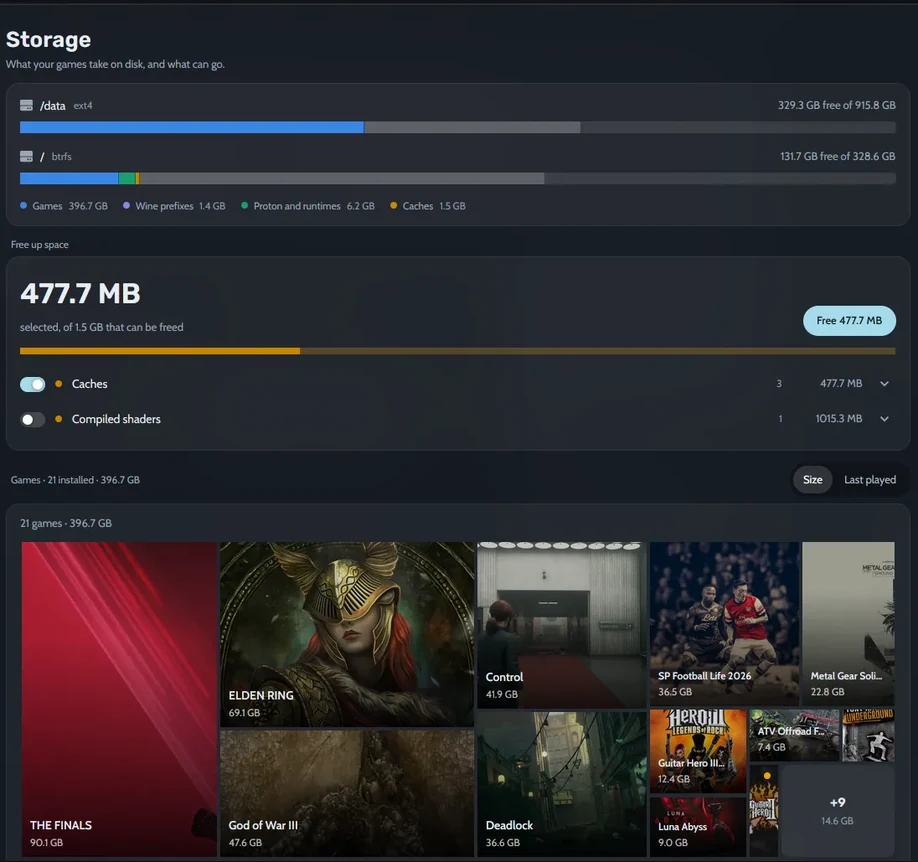</a><br /><sub><b>Storage</b></sub></td>
  </tr>
</table>

## Light on your PC

A single native process drawn on the GPU, with no bundled browser like Electron-based launchers carry. The idle numbers come from [`scripts/idle-cost.sh`](scripts/idle-cost.sh), so you can check them on your own PC.

| | Heronite Usage |
|---|---|
| Memory while idle | **~190 MB** in a single process, **~95 MB** closed to the tray |
| CPU while idle | **~0.1%** (0.05 s of CPU time over 60 s) |
| Install size | **64 MB** (app + store login helper) |
| Start to library on screen | **~215 ms** median |


## Run from source

<details>
<summary>Show build instructions</summary>

<br>

You need stable Rust. On Linux, also `clang` and `lld`, a Vulkan driver, and GTK/WebKitGTK; on Windows, the Visual Studio Build Tools ("Desktop development with C++") and [CMake](https://cmake.org) on the `PATH` (it builds SDL, which reads the controllers in console mode). Heronite downloads legendary, gogdl, and nile itself; [Ludusavi](https://github.com/mtkennerly/ludusavi) is optional.

```bash
# quick build (the login window is its own binary, so build it too)
cargo build --profile quick -p heronite-epic-login && cargo run --profile quick -p heronite

# release build, installed for the current user (Linux)
scripts/install.sh

# installer and portable zip in dist\ (Windows, needs Inno Setup 6.3 or later)
powershell -ExecutionPolicy Bypass -File scripts\windows\package.ps1
```

</details>


## Contributors

Heronite is better because of the people who gave their time to it. Thank you! 💜

<a href="https://github.com/RafaelGoulartB/Heronite/graphs/contributors">
  
</a>

Feel free to contribute too: every [pull request](https://github.com/RafaelGoulartB/Heronite/pulls) and [issue](https://github.com/RafaelGoulartB/Heronite/issues) is welcome!

## License

Copyright (C) 2026 [Rafael Goulart](https://www.linkedin.com/in/rafael-goulartb/)

Licensed under the [GNU General Public License v3.0](LICENSE). Third-party components keep their own licenses; see [THIRD-PARTY-NOTICES.md](THIRD-PARTY-NOTICES.md).

## Contact

- **Questions and ideas:** [Discussions](https://github.com/RafaelGoulartB/Heronite/discussions)
- **Bugs:** [Issues](https://github.com/RafaelGoulartB/Heronite/issues)
- **Contributing:** start with [CONTRIBUTING.md](CONTRIBUTING.md) and the [architecture notes](docs/ARCHITECTURE.md)
- **Security problems:** report them privately, as [SECURITY.md](SECURITY.md) explains
- **Anything else:** [hello@heronite.app](mailto:hello@heronite.app)
